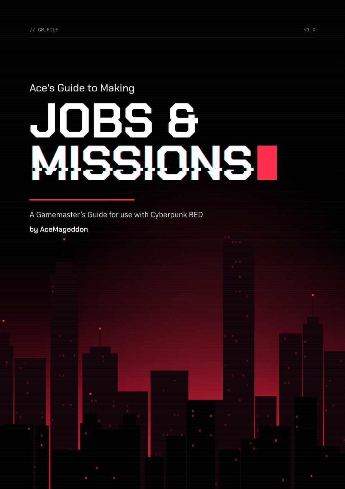
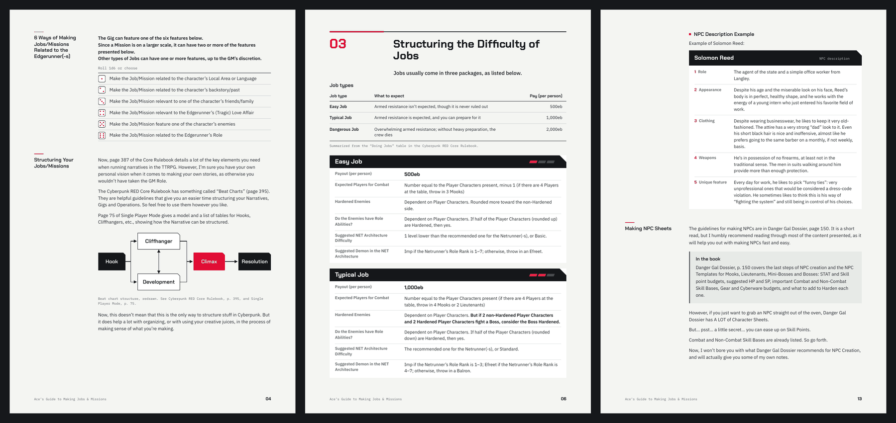

# TTRPG Design

Tabletop RPG writing and game-master tools by AceMageddon.

## Ace's Guide to Making Jobs & Missions

*A Gamemaster's Guide for use with Cyberpunk RED*

A 20-page guide for running a long Cyberpunk RED campaign as a chain of Jobs and Missions. It covers how to build Street Arcs and Mission Arcs, how much opposition to put in front of a crew of any size, what NET Architecture and Demons to give the crew's Netrunner, how to write NPCs players remember, and a Promotions system for scaling the fights that close an arc.

**[Read the PDF](cyberpunk-red/jobs-and-missions/Aces-Guide-to-Making-Jobs-and-Missions.pdf)**

---

Ace's Guide to Making Jobs & Missions is unofficial content provided under the Homebrew Content Policy of R. Talsorian Games and is not approved or endorsed by RTG. This content references materials that are the property of R. Talsorian Games and its licensees.
